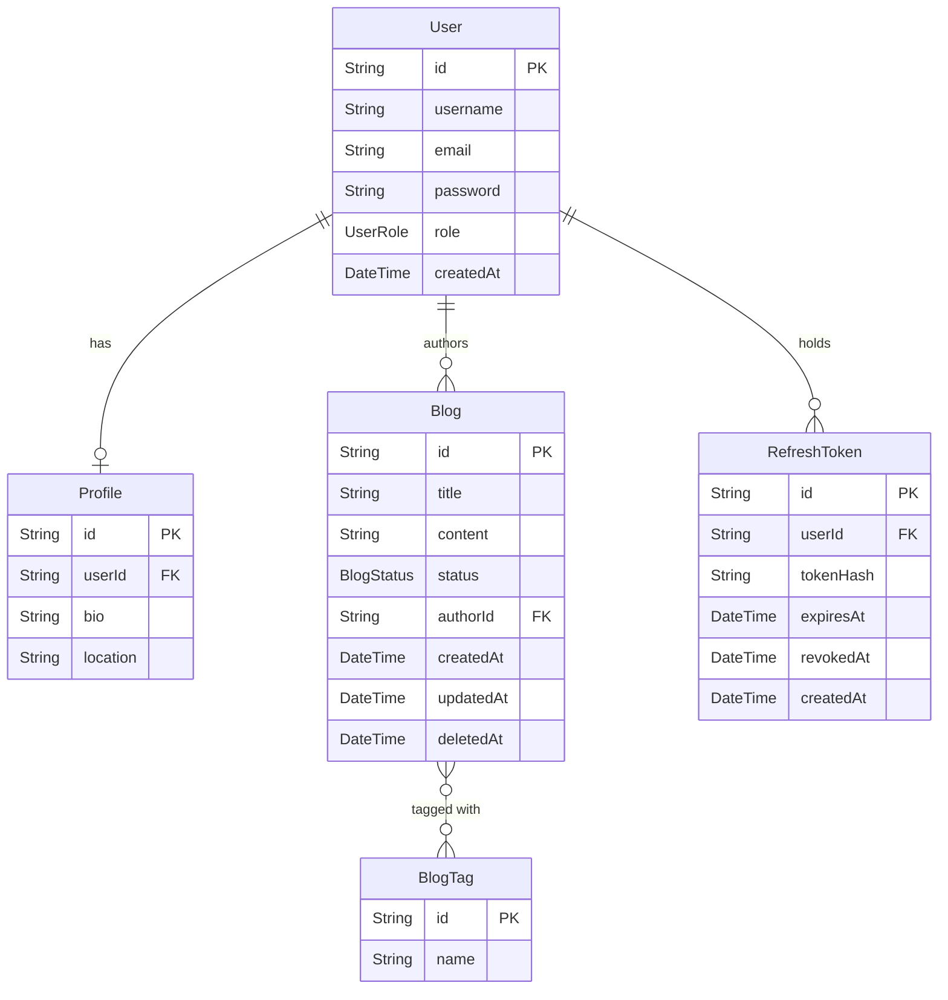

# blog-rbac-backend

A RESTful blog management API with JWT authentication, refresh token rotation, and three-tier role-based access control, built with Node.js, TypeScript, Express, and PostgreSQL via Prisma ORM.

---

## Tech Stack

| Layer | Technology |
|---|---|
| Runtime | Node.js 18+ |
| Language | TypeScript 5 (strict mode) |
| Framework | Express 4 |
| ORM | Prisma 5 + PostgreSQL |
| Auth | JWT (`jsonwebtoken`) + opaque refresh tokens |
| Password hashing | bcryptjs (cost factor 10) |
| Validation | Zod (strict schemas — unknown fields rejected) |
| Logging | Winston (console + rotating file, up to 5 × 5 MB) |
| API docs | Swagger UI (`/api-docs`) |
| Security | Helmet, CORS, tiered express-rate-limit |

---

## Key Features

- **Refresh token rotation with reuse detection** — refresh tokens are 96-char hex strings hashed with SHA-256 before storage. On every `/auth/refresh` the old token is revoked and a new pair is issued. Presenting a previously-revoked token immediately revokes *all* active sessions for that user (replay attack mitigation).
- **Three-tier RBAC enforced at the route layer** — `ADMIN`, `MODERATOR`, and `USER` roles are composed via `authenticate` + `authorize` middleware. Services apply a second role check for defense-in-depth.
- **Role-scoped data access** — `GET /blogs` returns all non-deleted blogs for ADMIN, only `DRAFT`/`PENDING` for MODERATOR, and only the caller's own posts for USER.
- **Soft delete with admin restore** — deleted blogs set `deletedAt` rather than being removed; ADMIN can restore them via `POST /blogs/:id/restore`.
- **Four-tier rate limiting** — global catch-all (200 req/15 min), strict auth limit (20 req/15 min on signup/login), token limit (30 req/15 min on refresh/logout), and write limit (50 req/15 min on mutating blog endpoints).
- **Blog filtering** — `GET /blogs` accepts `?status=`, `?tag=`, and `?q=` on top of pagination. Filters compose with the role-scoped base query; a MODERATOR requesting `?status=PUBLISHED` gets an empty result (correct — they cannot see published posts).
- **Structured audit logging with redaction** — every request/response is logged as JSON via Winston. Fields named `password`, `token`, or `authorization` are replaced with `[REDACTED]` before writing to disk.

---

## Architecture

```
blog-rbac-backend/
├── prisma/
│   ├── schema.prisma          # Data model: User, Profile, Blog, BlogTag, RefreshToken
│   └── migrations/            # SQL migration history
├── src/
│   ├── app.ts                 # Express setup, middleware wiring, server start
│   ├── config/
│   │   ├── jwtConfig.ts       # Token sign/verify helpers; crashes at startup if JWT_SECRET unset
│   │   ├── rateLimiter.ts     # globalLimiter, authLimiter, tokenLimiter, writeLimiter
│   │   └── swagger.ts         # OpenAPI 3.0 spec, served at /api-docs
│   ├── lib/
│   │   └── prisma.ts          # Shared PrismaClient singleton
│   ├── types/
│   │   └── express.d.ts       # Augments Express.Request with req.user
│   ├── middlewares/
│   │   ├── authMiddleware.ts  # authenticate (JWT) + authorize (role guard)
│   │   ├── errorMiddleware.ts # Global error handler; maps Prisma/Zod errors to HTTP codes
│   │   └── loggingMiddleware.ts # Winston request logger with body redaction
│   ├── routes/
│   │   ├── authRoute.ts       # /auth — rate-limited signup/login
│   │   ├── blogRoute.ts       # /blogs — write endpoints rate-limited
│   │   └── userRoute.ts       # /users
│   ├── controllers/
│   │   ├── authController.ts  # Parses/validates input → calls service → HTTP response
│   │   ├── blogController.ts
│   │   └── userController.ts
│   ├── services/
│   │   ├── authService.ts     # Hashes passwords, issues/rotates JWTs and refresh tokens
│   │   ├── blogService.ts     # Role-scoped queries, tag upserts, soft delete, pagination, filtering
│   │   └── userService.ts     # Profile upsert, paginated user list
│   └── utils/
│       ├── validationUtil.ts  # Zod strict schemas for all request bodies
│       ├── errorUtil.ts       # Typed error factories (badRequest, unauthorized, forbidden, notFound)
│       └── tokenUtil.ts       # crypto.randomBytes + SHA-256 hash for refresh tokens
├── .env.example
├── postmanCollection.json
├── tsconfig.json
└── package.json
```

### Request flow

```
Client
  │
  ▼
Express (helmet · cors · json parser)
  │
  ├─► globalLimiter           — 200 req / 15 min per IP
  ├─► loggingMiddleware       — logs method/path/status; redacts sensitive fields
  │
  ├─► /api-docs               — Swagger UI (no auth required)
  │
  ├─► authRoute / blogRoute / userRoute
  │       │
  │       ├─► authLimiter / tokenLimiter / writeLimiter   — endpoint-specific rate limits
  │       ├─► authenticate                 — verifies JWT, attaches req.user
  │       ├─► authorize([…])               — checks req.user.role ∈ allowed roles
  │       └─► Controller
  │               │  validates body with Zod (.strict()); parses ?status/?tag/?q filters
  │               └─► Service             — Prisma query → returns plain object
  │
  ├─► errorLoggingMiddleware  — logs unhandled errors
  └─► errorHandler            — maps Error → JSON response
```

---

## Design Decisions

- **Fail-fast on missing secrets** — `jwtConfig.ts` throws at module load time if `JWT_SECRET` is absent. This turns a silent runtime vulnerability (a weak fallback key) into an immediate startup crash.

- **Opaque refresh tokens, not JWTs** — refresh tokens are random bytes hashed with SHA-256 before storage. A DB breach exposes only hashes, not usable tokens. Rotation + reuse detection limits the blast radius of a stolen token; stateless JWTs cannot support either.

- **Role enforcement at the route layer, not only the service layer** — `authorize()` middleware rejects unauthorized callers before the controller runs. Services contain a second check for defense-in-depth (e.g. `deleteBlog`, `updateBlogStatus`), but the primary gate is at the route.

- **Zod strict schemas as the API contract** — all request bodies are parsed with `.strict()`, which rejects unknown fields (e.g. `role: "ADMIN"` in a signup body) with a `400` rather than silently dropping them. This eliminates mass-assignment attacks and makes the accepted surface explicit.

- **Typed error propagation** — services throw errors created by factory helpers (`forbidden`, `notFound`, `unauthorized`, `badRequest`) from `errorUtil.ts`. Each error carries a `statusCode` property. Controllers read `error.statusCode` directly instead of pattern-matching on error message strings, and the global error handler handles `CustomError` by name.

---

## API Reference

### Authentication (`/auth`)

| Method | Endpoint | Auth | Role | Description |
|---|---|---|---|---|
| POST | `/auth/signup` | No | — | Register; role defaults to `USER` |
| POST | `/auth/login` | No | — | Returns `accessToken` + `refreshToken` |
| POST | `/auth/refresh` | No | — | Rotate refresh token; returns new pair |
| POST | `/auth/logout` | No | — | Revoke the supplied refresh token |
| GET | `/auth/profile` | Bearer | Any | Caller's profile |

Signup and login are rate-limited to **20 requests per IP per 15 minutes**. Refresh and logout are rate-limited to **30 requests per IP per 15 minutes**.

**Token flow**
- `accessToken` — short-lived JWT (default `1h`), passed as `Authorization: Bearer <token>`
- `refreshToken` — opaque 96-char hex token (7-day TTL), stored as SHA-256 hash in DB; used only at `/auth/refresh`
- On each refresh, the old token is revoked before a new pair is issued. Presenting a revoked token immediately revokes all active sessions for that user.

### Users (`/users`)

| Method | Endpoint | Auth | Role | Description |
|---|---|---|---|---|
| PATCH | `/users/profile` | Bearer | Any | Update caller's `bio` and/or `location` |
| GET | `/users` | Bearer | ADMIN | List all users (paginated) |
| GET | `/users/:id` | Bearer | ADMIN | Get a single user with profile |

### Blogs (`/blogs`)

| Method | Endpoint | Auth | Role | Description |
|---|---|---|---|---|
| POST | `/blogs/create` | Bearer | Any | Create a post (starts as `DRAFT`) |
| GET | `/blogs` | Bearer | Any | List blogs, filtered by caller's role (paginated) |
| PATCH | `/blogs/:id/status` | Bearer | ADMIN, MODERATOR | Update blog status |
| DELETE | `/blogs/:id` | Bearer | Author or ADMIN | Soft-delete (`deletedAt` set) |
| POST | `/blogs/:id/restore` | Bearer | ADMIN | Restore a soft-deleted blog |

Write endpoints (`POST /blogs/create`, `PATCH`, `DELETE`, `POST /restore`) are rate-limited to **50 requests per IP per 15 minutes**.

**Blog status values:** `DRAFT → PENDING → PUBLISHED`

**Role-scoped visibility for `GET /blogs`**

| Role | Sees |
|---|---|
| ADMIN | All non-deleted blogs (with author info) |
| MODERATOR | `DRAFT` and `PENDING` blogs (with author info) |
| USER | Own posts only |

**Pagination** — `GET /blogs` and `GET /users` accept `?page=<n>&limit=<n>` (defaults: `page=1`, `limit=20`, max `limit=100`).

**Filtering** — `GET /blogs` additionally accepts:

| Query param | Type | Description |
|---|---|---|
| `?status=` | `DRAFT \| PENDING \| PUBLISHED` | Filter by blog status (role-scoped — MODERATOR cannot see PUBLISHED) |
| `?tag=` | string | Exact tag name match (case-insensitive) |
| `?q=` | string | Case-insensitive substring search across `title` and `content` |

Filters compose with each other and with the role-scoped base query. An invalid `?status=` value is silently ignored.

Response envelope:
```json
{
  "data": [...],
  "meta": { "total": 42, "page": 1, "limit": 20, "totalPages": 3 }
}
```

---

## Data Model

### Tables

| Model | Key fields |
|---|---|
| `User` | `id` (cuid), `username` (unique), `email` (unique), `password` (bcrypt), `role` (default `USER`), `createdAt` |
| `Profile` | `id`, `userId` (FK → User, unique), `bio?`, `location?` |
| `Blog` | `id`, `title`, `content`, `status` (default `DRAFT`), `authorId` (FK → User), `createdAt`, `updatedAt`, `deletedAt?` |
| `BlogTag` | `id`, `name` (unique) — many-to-many with `Blog` via implicit join table |
| `RefreshToken` | `id`, `userId` (FK → User, indexed), `tokenHash` (SHA-256, unique), `expiresAt`, `revokedAt?`, `createdAt` |

### Enums

- `UserRole`: `ADMIN | MODERATOR | USER`
- `BlogStatus`: `DRAFT | PENDING | PUBLISHED`

### ER Diagram



---

## Getting Started

### Prerequisites

- Node.js 18+
- PostgreSQL 14+ (or Docker)
- npm

### 1. Clone and install

```bash
git clone <repo-url>
cd blog-rbac-backend
npm install
```

### 2. Start PostgreSQL (Docker — skip if you have a local instance)

```bash
docker run --name blog-postgres \
  -e POSTGRES_PASSWORD=mysecretpassword \
  -e POSTGRES_DB=blog_rbac \
  -p 5432:5432 \
  -d postgres
```

### 3. Configure environment

```bash
cp .env.example .env
```

Set at minimum:

```env
DATABASE_URL="postgresql://postgres:<password>@localhost:5432/blog_rbac?schema=public"
JWT_SECRET="<output of: openssl rand -hex 64>"
```

The server will refuse to start if `JWT_SECRET` is not set.

### 4. Apply migrations and generate Prisma client

```bash
npx prisma migrate deploy   # applies committed migrations; use this on any new machine
npx prisma generate         # usually runs automatically via postinstall; run manually if needed
```

> Use `migrate deploy` (not `migrate dev`) for initial setup — it applies the committed migration history without creating new files.

### 5. Run

```bash
# Development
npm run dev

# Production
npm run build
npm start
```

Server listens on `PORT` (default `3000`).

### Prisma Studio (optional)

```bash
npx prisma studio
```

---

## Testing and API Docs

**Tests** — run with `npm test` (Jest + ts-jest, 88 tests across 7 suites, no database required).

| Suite | What it covers |
|---|---|
| `validation.test.ts` | Every Zod schema — valid inputs, length boundaries, enum values, `.strict()` rejecting extra fields |
| `tokenUtil.test.ts` | `generateRawToken` length/format/uniqueness; `hashToken` determinism and collision resistance |
| `jwtConfig.test.ts` | Token round-trip, tampered token, garbage string |
| `authMiddleware.test.ts` | `authenticate` with valid/missing/invalid token; `authorize` with matching role, wrong role, absent `req.user` |
| `authService.test.ts` | Signup/login happy paths, duplicate key error, no user enumeration (same error for wrong email and wrong password), refresh rotation, replay attack revokes all sessions, idempotent logout |
| `blogService.test.ts` | Role-scoped `where` clauses, pagination math, ordering, soft delete permissions, restore guard, status update guard, filter params (status/tag/q) |
| `edgeCases.test.ts` | Whitespace inputs, boundary values, malformed auth headers, JWT payload contents |

**Swagger UI** — start the server and open `http://localhost:<PORT>/api-docs`. Click **Authorize** to enter your JWT once; it will be applied to all subsequent requests.

**Postman** — import `postmanCollection.json` from the repo root. Set the `{{token}}` collection variable after calling `/auth/login`.

---

## Future Improvements

- **Integration / E2E tests** — unit tests cover services and middleware in isolation. Supertest tests against a real test database would cover the full request lifecycle: auth flow, token rotation, role checks across HTTP, soft delete, and filter combinations.
- **Full-text search** — the current `?q=` filter uses Prisma `contains` (SQL `LIKE`). Replacing it with PostgreSQL `pg_trgm` or a dedicated search index would make keyword search performant at scale.
- **Revoke all sessions endpoint** — `POST /auth/logout-all` that sets `revokedAt` on every active `RefreshToken` for the calling user, useful after a password change or suspected account compromise.
