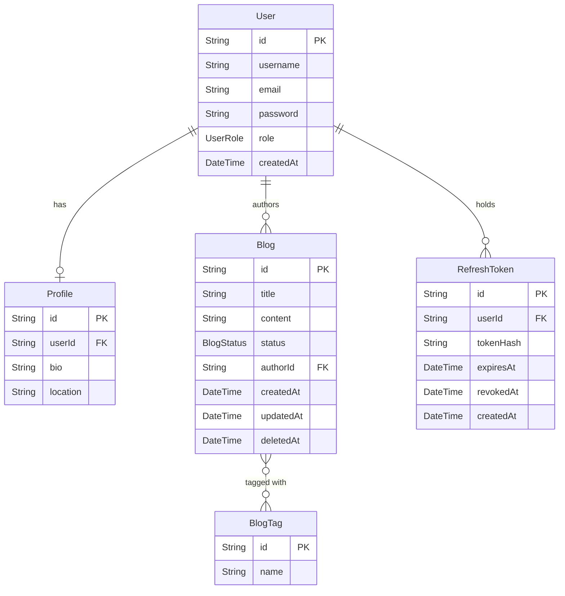

# blog-rbac-backend

A RESTful blog management API with role-based access control (RBAC), built with Node.js, TypeScript, Express, and PostgreSQL via Prisma ORM.

---

## Tech Stack

| Layer | Technology |
|---|---|
| Runtime | Node.js 18+ |
| Language | TypeScript 5 (strict mode) |
| Framework | Express 4 |
| ORM | Prisma 5 + PostgreSQL |
| Auth | JWT (`jsonwebtoken`) |
| Password hashing | bcryptjs (cost factor 10) |
| Validation | Zod |
| Logging | Winston (console + rotating file) |
| Security | Helmet, CORS, express-rate-limit |

---

## Key Features

- **JWT authentication** — stateless Bearer-token auth; tokens embed `userId` and `role` so every request is self-contained
- **Three-tier RBAC** — `ADMIN`, `MODERATOR`, and `USER` roles enforced at the route level via composable `authenticate` / `authorize` middleware
- **Blog lifecycle** — posts move through `DRAFT → PENDING → PUBLISHED`; only ADMIN/MODERATOR can change status
- **Role-scoped data access** — `GET /blogs` returns all blogs for ADMIN, DRAFT+PENDING for MODERATOR, and only the caller's own blogs for USER
- **Offset pagination** — all list endpoints accept `?page=&limit=` and return a `{ data, meta }` envelope
- **Structured audit logging** — every request/response logged as JSON with sensitive fields (`password`, `token`) automatically redacted

---

## Architecture

```
blog-rbac-backend/
├── prisma/
│   ├── schema.prisma          # Data model (User, Profile, Blog, BlogTag)
│   └── migrations/            # SQL migration history
├── src/
│   ├── app.ts                 # Express setup, middleware wiring, server start
│   ├── config/
│   │   └── jwtConfig.ts       # Token sign/verify helpers; crashes at startup if JWT_SECRET unset
│   ├── lib/
│   │   └── prisma.ts          # Shared PrismaClient singleton
│   ├── types/
│   │   └── express.d.ts       # Augments Express.Request with req.user
│   ├── middlewares/
│   │   ├── authMiddleware.ts  # authenticate (JWT) + authorize (role guard)
│   │   ├── errorMiddleware.ts # Global error handler; maps Prisma/Zod errors to HTTP codes
│   │   └── loggingMiddleware.ts # Winston request logger with body redaction
│   ├── routes/
│   │   ├── authRoute.ts       # /auth — rate-limited signup/login
│   │   ├── blogRoute.ts       # /blogs
│   │   └── userRoute.ts       # /users
│   ├── controllers/
│   │   ├── authController.ts  # Input parsing → service call → HTTP response
│   │   ├── blogController.ts
│   │   └── userController.ts
│   ├── services/
│   │   ├── authService.ts     # Hashes passwords, generates JWTs
│   │   ├── blogService.ts     # Role-scoped queries, tag upserts, pagination
│   │   └── userService.ts     # Profile upsert, paginated user list
│   └── utils/
│       ├── validationUtil.ts  # Zod schemas for all request bodies
│       └── errorUtil.ts       # Typed error factory helpers
├── .env.example
├── postmanCollection.json
├── tsconfig.json
└── package.json
```

### Request flow

```
Client
  │
  ▼
Express (helmet, cors, json parser)
  │
  ├─► loggingMiddleware       — logs method/path/status; redacts passwords
  │
  ├─► authRoute / blogRoute / userRoute
  │       │
  │       ├─► authenticate    — verifies JWT, attaches req.user
  │       ├─► authorize([…])  — checks req.user.role ∈ allowed roles
  │       └─► Controller      — validates body (Zod), calls Service
  │               │
  │               └─► Service — Prisma query → returns plain object
  │
  ├─► errorLoggingMiddleware  — logs unhandled errors
  └─► errorHandler            — maps Error → JSON response
```

---

## Design Decisions

- **Fail-fast on missing secrets** — `jwtConfig.ts` throws at module load time if `JWT_SECRET` is absent. This turns a silent runtime vulnerability (weak fallback key) into an immediate startup crash that CI and health checks will catch.

- **Role enforcement at the route layer, not the service layer** — `authorize()` middleware rejects unauthorized callers before the controller runs. Services do apply their own role checks for defense-in-depth (e.g., `updateBlogStatus`), but the primary gate is at the route.

- **Single Prisma instance** — all services import the same `lib/prisma.ts` singleton. Instantiating `new PrismaClient()` per module opens multiple connection pools and can exhaust the database under modest load.

- **Zod for validation** — schemas live in `validationUtil.ts` and are called in controllers before any DB access. Zod's `.parse()` throws with a typed `ZodError` on invalid input, which the global error handler maps to `400`.

- **Opaque refresh tokens, not JWT** — refresh tokens are random bytes hashed with SHA-256 before storage. This means a DB breach exposes only hashes, not usable tokens. It also allows precise per-token revocation, which is impossible with stateless JWTs. Token reuse detection (revoked token presented again → revoke all user sessions) limits the blast radius of a stolen token.

---

## API Reference

### Authentication (`/auth`)

| Method | Endpoint | Auth | Role | Description |
|---|---|---|---|---|
| POST | `/auth/signup` | No | — | Register a new user (role defaults to USER) |
| POST | `/auth/login` | No | — | Authenticate; returns `accessToken` + `refreshToken` |
| POST | `/auth/refresh` | No | — | Exchange a valid refresh token for a new token pair |
| POST | `/auth/logout` | No | — | Revoke the supplied refresh token |
| GET | `/auth/profile` | Bearer | Any | Get the caller's profile |

Signup and login are rate-limited to **20 requests per IP per 15 minutes**.

**Token flow:**
- `accessToken` — short-lived JWT (default 1h), passed as `Authorization: Bearer <token>`
- `refreshToken` — opaque 96-char hex token (7-day TTL), stored hashed in DB; used only at `/auth/refresh`
- On each refresh, the old token is revoked before a new pair is issued (rotation). If a revoked token is reused, all active tokens for that user are immediately revoked.

### Users (`/users`)

| Method | Endpoint | Auth | Role | Description |
|---|---|---|---|---|
| PATCH | `/users/profile` | Bearer | Any | Update the caller's bio and/or location |
| GET | `/users` | Bearer | ADMIN | List all users (paginated) |
| GET | `/users/:id` | Bearer | ADMIN | Get a single user with profile |

### Blogs (`/blogs`)

| Method | Endpoint | Auth | Role | Description |
|---|---|---|---|---|
| POST | `/blogs/create` | Bearer | Any | Create a blog post (starts as DRAFT) |
| GET | `/blogs` | Bearer | Any | List blogs filtered by caller's role (paginated) |
| PATCH | `/blogs/:id/status` | Bearer | ADMIN, MODERATOR | Update a blog's status |
| DELETE | `/blogs/:id` | Bearer | Author or ADMIN | Soft-delete a blog (sets `deletedAt`) |
| POST | `/blogs/:id/restore` | Bearer | ADMIN | Restore a soft-deleted blog |

**Pagination** — `GET /blogs` and `GET /users` accept `?page=<n>&limit=<n>` (default: `page=1`, `limit=20`, max `limit=100`).

Response envelope:
```json
{
  "data": [...],
  "meta": { "total": 42, "page": 1, "limit": 20, "totalPages": 3 }
}
```

---

## Data Model

### Tables

| Model | Key fields |
|---|---|
| `User` | `id` (cuid), `username` (unique), `email` (unique), `password` (bcrypt), `role` (UserRole) |
| `Profile` | `id`, `userId` (FK → User, unique), `bio?`, `location?` |
| `Blog` | `id`, `title`, `content`, `status` (BlogStatus), `authorId` (FK → User), `deletedAt?` |
| `BlogTag` | `id`, `name` (unique) — many-to-many with Blog via implicit join table |
| `RefreshToken` | `id`, `userId` (FK → User), `tokenHash` (SHA-256 of raw token, unique), `expiresAt`, `revokedAt?` |

### Enums

- `UserRole`: `ADMIN | MODERATOR | USER`
- `BlogStatus`: `DRAFT | PENDING | PUBLISHED`

### ER Diagram



---

## Getting Started

### Prerequisites

- Node.js 18+
- PostgreSQL 14+
- npm

### Install

```bash
git clone <repo-url>
cd blog-rbac-backend
npm install
```

### Configure environment

```bash
cp .env.example .env
# Edit .env — set DATABASE_URL and JWT_SECRET at minimum
```

> **Security note:** `JWT_SECRET` must be set. The server will refuse to start without it. Use `openssl rand -hex 64` to generate a strong value.

### Migrate and run

```bash
# Apply DB migrations (creates tables)
npm run migrate

# Development (ts-node, hot reload via nodemon)
npm run dev

# Production
npm run build
npm start
```

Server listens on `PORT` (default `3000`).

### Prisma Studio (optional)

```bash
npx prisma studio
```

---

## Testing and API Docs

**Tests** — there are currently no automated tests in this repository. See [Future Improvements](#future-improvements).

**Postman** — import `postmanCollection.json` from the repo root. Set the `{{token}}` collection variable after calling `/auth/login`.

---

## Security Notes

- **No secrets found in git history.** The `.env` file is gitignored. `jwtConfig.ts` previously had a `'fallback_secret'` hardcoded default; this has been removed and the server now crashes at startup if `JWT_SECRET` is missing.
- **Request bodies are redacted in logs.** Fields named `password`, `token`, or `authorization` are replaced with `[REDACTED]` before writing to `logs/app.log`.
- **CORS defaults to `*`** in development. Set `CORS_ORIGIN` to a specific origin in production.

---

## Future Improvements

- **Integration tests** — no test suite exists. Jest + Supertest with a test database would cover the auth flow, role checks, pagination, soft delete, and token rotation.
- **"Revoke all sessions" endpoint** — `POST /auth/logout-all` that sets `revokedAt` on every active `RefreshToken` for the calling user, useful after a password change or account compromise.
- **Blog search and filtering** — `GET /blogs` currently only supports pagination. Adding `?status=`, `?tag=`, and `?q=` (full-text search via Prisma's `search` mode or `pg_trgm`) would make the API meaningfully queryable.
